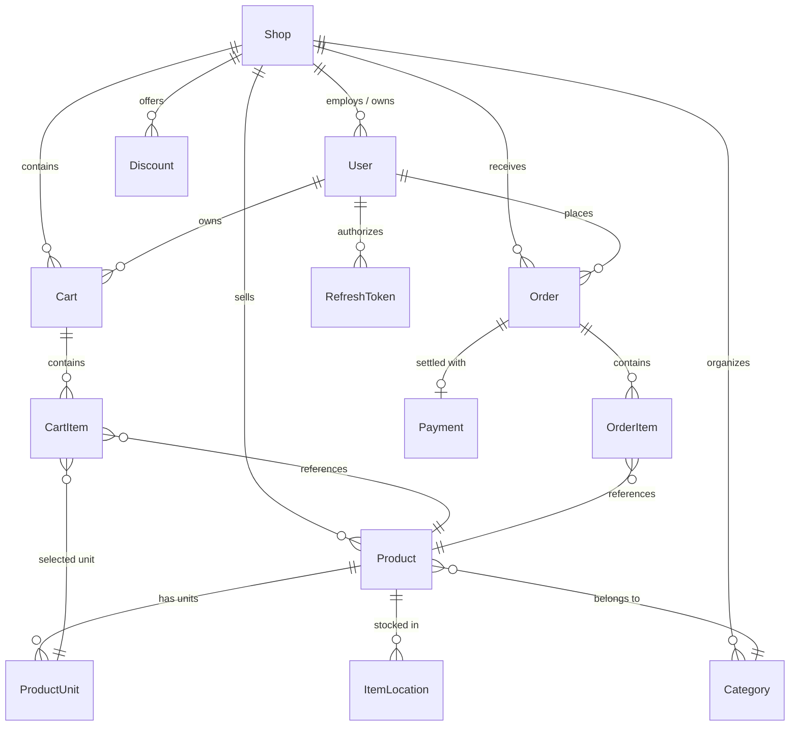

# Multi-Tenant E-Commerce & Retail Management System

A multi-tenant e-commerce backend where multiple independent shops share a single deployment but stay completely isolated from each other. Built with **Spring Boot 3 / Java 17**, **Spring Security 6**, **Spring Data JPA**, and **MySQL**.

Each shop gets its own product catalog, inventory, orders, discounts, and customers. The system handles both guest and authenticated shopping flows, multi-unit product pricing (e.g. sell by piece, box, or carton), and a refresh-token based auth system.

---

## Architecture Overview

Every tenant-scoped entity (`Product`, `Category`, `Cart`, `Order`, `Discount`, etc.) has a foreign key to a `Shop`. A thread-bound `ShopContext` (ThreadLocal) carries the current tenant through the request lifecycle, set during filter processing and cleared in a `finally` block to avoid thread pool leakage.

### Request Lifecycle & Filter Pipeline

```mermaid
sequenceDiagram
    autonumber
    actor Client
    participant CORS as CorsFilter
    participant RateLimit as RateLimitingFilter
    participant JWT as JwtAuthenticationFilter
    participant Tenant as ShopResolutionFilter
    participant Controller as Spring MVC Controller
    participant Service as Business Service Layer
    participant DB as MySQL Database

    Client->>CORS: HTTP Request (Headers: Authorization, X-Shop-Key)
    CORS->>RateLimit: Passed CORS Validation
    RateLimit->>JWT: Token Bucket Rate Check
    alt Bearer Token Present
        JWT->>JWT: Validate signature & claims
        JWT->>JWT: Set SecurityContextHolder
    end
    JWT->>Tenant: Forward Request
    Tenant->>Tenant: Resolve Shop via X-Shop-Key or JWT claims
    Tenant->>Tenant: ShopContext.setCurrentShop(shop)
    Tenant->>Controller: Route to Controller endpoint
    Controller->>Service: Execute Business Logic (scoped to ShopContext)
    Service->>DB: Query / Mutate Shop-Isolated Tables
    DB-->>Service: Result Data
    Service-->>Controller: DTO Response
    Controller-->>Tenant: HTTP Response
    Tenant->>Tenant: finally { ShopContext.clear(); }
    Tenant-->>Client: 200 OK / Response Body
```

---

## Features

### Multi-Tenancy & Shop Context
- Shop is resolved from either the `X-Shop-Key` header (for public/guest endpoints) or from JWT claims (for authenticated users).
- Three roles: `SUPER_ADMIN` (platform-wide), `SHOP_ADMIN` (manages their own shop), `CUSTOMER` (shopping).

### Auth
- Short-lived JWT access tokens (15 min) + stateful refresh tokens (24 hr, stored in DB with device/IP metadata).
- "Logout all devices" and password-change both purge all refresh tokens for a user — effectively killing all active sessions.
- Email OTP verification (6-digit, 10-minute expiry, single-use).
- Passwords hashed with BCrypt.

### Product Catalog & Inventory
- Hierarchical categories (recursive parent-child, unlimited depth).
- Products can have multiple selling units (e.g. Piece, Box of 10, Carton of 100) with a conversion factor — stock deducts correctly regardless of which unit is purchased.
- Multi-location stock tracking (`ItemLocation`) — shelves, racks, warehouses.

### Cart & Discounts
- Guest carts tracked via `sessionId` header (UUID fallback if not provided). Registered user carts are tied to their account.
- Carts are scoped per `(sessionId, shop_id)` so a browser session doesn't bleed across shops.
- Discount codes support: percentage or flat amount, minimum order subtotal, date range, and usage limits.

### Orders & Checkout
- Stock deduction happens inside a `@Transactional` block — no overselling under concurrent load.
- Payment records store only masked card numbers (`****-****-****-1234`); CVV and expiry are never persisted.
- Orders follow a simple state machine: `PENDING` → `PROCESSING` → `SHIPPED` → `DELIVERED` / `CANCELLED`.

### Security & Other
- Rate limiting on auth endpoints (in-memory sliding window).
- File serving checks that resolved paths stay within the upload directory (path traversal guard).
- Notification endpoints verify ownership before returning data.
- Optional Gemini API integration for phonetic/fuzzy product search.

---

## Entity Relationship Overview



---

## API Documentation (Swagger / OpenAPI 3)

The API is fully documented using OpenAPI 3.0 via Springdoc WebMVC UI.

### Accessing Swagger UI
1. Start the application.
2. Navigate to: **`http://localhost:8080/api/swagger-ui/index.html`** (or `http://localhost:8080/api/swagger-ui.html`)
3. OpenAPI raw JSON specification: **`http://localhost:8080/api/v3/api-docs`**

### Authenticating in Swagger UI
1. Send a `POST` request to `/api/auth/login` with your credentials:
   ```json
   {
     "email": "admin@example.com",
     "password": "yourPassword123"
   }
   ```
2. Copy the `accessToken` from the response.
3. Click the **Authorize** button (lock icon at the top right of the Swagger UI).
4. Enter the token in the format: `Bearer <your_token_here>` (or paste directly).
5. All subsequent calls executed from Swagger UI will include the Bearer authentication header.
6. When testing shop-scoped endpoints, pass the header `X-Shop-Key: your-shop-slug`.

---

## Quickstart & Setup

### Prerequisites
- **Java 17+** (JDK)
- **Maven 3.8+** (or use bundled `./mvnw`)
- **MySQL 8.0+** (or Docker)

---

### Option 1: Run with Docker Compose (Recommended)

One single command spins up MySQL and the Spring Boot application in isolated containers with automated health checks:

```bash
docker compose up --build
```

- **Backend API**: `http://localhost:8080/api`
- **Swagger UI**: `http://localhost:8080/api/swagger-ui/index.html`
- **MySQL Port**: `3306` (Database: `ecommerce_backend`, User: `root`, Password: `root`)

To tear down:
```bash
docker compose down -v
```

---

### Option 2: Local Development Setup

#### 1. Configure Database
Create a MySQL database:
```sql
CREATE DATABASE ecommerce_backend CHARACTER SET utf8mb4 COLLATE utf8mb4_unicode_ci;
```

#### 2. Configure Environment Variables
You can override default settings in `src/main/resources/application.properties` or set environment variables:

| Variable | Description | Default |
|---|---|---|
| `DB_HOST` | MySQL hostname | `localhost` |
| `DB_PORT` | MySQL port | `3306` |
| `DB_NAME` | Database name | `ecommerce_backend` |
| `DB_USERNAME` | Database username | `root` |
| `DB_PASSWORD` | Database password | `root` |
| `JWT_SECRET` | 256-bit Base64 secret key | *(Preconfigured default for dev)* |
| `GEMINI_API_KEY` | Optional AI search key | `""` |
| `BACKUP_ENABLED` | Daily DB dump scheduler toggle | `false` |

#### 3. Build & Run
```bash
# Build the project and run tests
mvn clean package

# Run the Spring Boot application
mvn spring-boot:run
```

---

## Running Automated Tests

The test suite uses **H2 in-memory database** (`application-test.properties`) so tests run completely decoupled from external MySQL instances.

```bash
mvn clean test
```

### Test Coverage Highlights
- **Auth & JWT Lifecycle**: Token issuance, claims parsing, expired token rejection, refresh token rotation.
- **Cart Operations**: Session cart creation, duplicate item aggregation, quantity updates, removal.
- **Checkout Processing**: Order generation, total calculation, discount application, stock integrity.
- **Rate Limiting**: Sliding window throttling verification.

---

## Project Structure

```
src/main/java/com/ecommerce/backend/
├── config/              # Security, CORS, OpenAPI, WebMvc configuration
├── controller/          # REST API endpoints (Auth, Shop, Product, Cart, Order, etc.)
├── dto/                 # Data Transfer Objects & validation annotations
├── entity/              # JPA Domain Entities & Table definitions
├── exception/           # Global exception handler & custom API error models
├── repository/          # Spring Data JPA repositories
├── security/            # JWT filters, ShopResolutionFilter, ShopContext (ThreadLocal)
└── service/             # Core business logic implementations
```

---

## License

This project is licensed under the Apache License 2.0.
